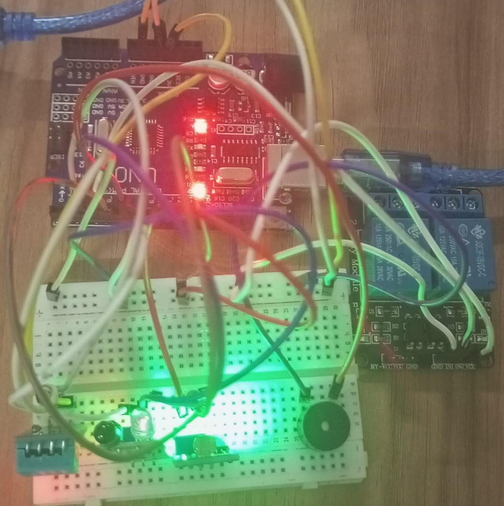

# Smart-Automatic-Water-Dispenser-with-Temperature-Alert
# A Simple Arduino-Based Automation Project
# About the Project
This project is a smart water dispensing system that uses sensors to automate the process of dispensing water without physical contact. An IR sensor detects the presence of a hand, while an LDR module checks the surrounding light condition. When both conditions are satisfied, the Arduino activates a relay to turn ON the water pump for a few seconds.The project also includes a DHT11 temperature sensor to monitor the surrounding temperature. Whenever the temperature reaches 31°C or above, a buzzer is activated to provide an alert.The main idea behind this project is to bring together different sensors and components to create a simple and practical automation system.

# Features
- Touchless water dispensing using an IR sensor.
- Light-based system activation using an LDR module.
- Automatic water pump control through a relay.
- Temperature monitoring using a DHT11 sensor.
- Buzzer alert when the temperature reaches 31°C or above.
- Multiple sensor integration using a single Arduino Uno.

# Components Used
- Arduino Uno
- IR Sensor
- LDR Module
- DHT11 Temperature Sensor
- 1-Channel Relay Module
- Mini DC Water Pump
- Buzzer
- Jumper Wires
- Breadboard
- External power supply for the water pump

# How It Works
1. Light Detection

The LDR module detects the surrounding light condition and sends a digital signal to the Arduino.

2. Hand Detection

The IR sensor detects whether a hand is placed near it and sends the corresponding signal to the Arduino.

3. Water Dispensing

When both the IR and LDR sensor outputs are LOW, the Arduino activates the relay and the water pump starts running for 2 seconds.

When the required conditions are not satisfied, the pump remains OFF.

4. Temperature Monitoring

The DHT11 sensor continuously reads the surrounding temperature and sends the readings to the Arduino Serial Monitor.

5. Buzzer Alert

When the temperature reaches or exceeds 31°C, the buzzer turns ON. It remains OFF when the temperature is below the set limit.
## Hardware Connection

## Serial Monitor Output

## Arduino Code

[View Arduino Code](./waterdis.ino)

# What I Learned
While building this project, I got hands-on experience with:
- Interfacing multiple sensors with Arduino.
- Understanding digital inputs and outputs.
- Working with IR and LDR sensors.
- Controlling a water pump using a relay module.
- Reading temperature values using DHT11.
- Implementing conditions using if-else statements.
- Combining different hardware components into one project.

# Future Improvements
- Display temperature readings using an LCD.
- Improve water dispensing control.
- Add a water-level detection system.
- Make the setup more compact and user-friendly
This project helped me understand how different sensors can work together to build a simple real-time automation system.
